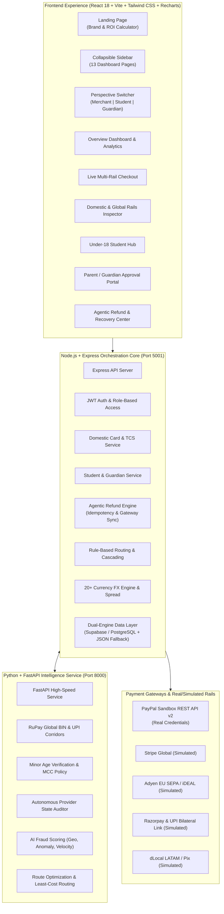

# ATLAS.PAY — International Payment Orchestration Platform

> **"Smarter Payments. Borderless Possibilities."**

[](#testing--verification)
[](#testing--verification)
[](#testing--verification)
[](#technology-stack)
[](#uiux-redesign--design-system)
[](#dual-engine-data-layer)
[](#)

ATLAS.PAY is an enterprise-grade, multi-rail **International Payment Orchestration Platform** that bridges the domestic-to-global payment divide. It unifies international gateways (**Stripe, Adyen, PayPal, Razorpay, dLocal**), unlocks cross-border Indian rails (**RuPay Global BINs and NIPL Bilateral UPI corridors**), enforces **Under-18 student financial guardrails with parent consent**, and eliminates false client chargebacks using **autonomous agentic refunds with idempotency protection**.

---

## 🏛️ System Architecture



---

## 🚀 Key Features Breakdown

### 1. Domestic Card & UPI Integration for International Payments
Indian shoppers and businesses frequently face declined payments when using domestic instruments for overseas purchases. ATLAS.PAY provides:
- **RuPay Global BIN Compatibility**: Distinguishes between RuPay Global cards co-badged with Discover/JCB/Diners Club (BINs `6521xx`, `6522xx`) and domestic-only PMJDY cards (BINs `6070xx`, `6071xx`).
- **NIPL Bilateral UPI International Corridors**: Verifies authorized merchant QR and fast-payment corridors across Singapore (PayNow), UAE (NeoPay / Mashreq), France (Lyra Network / Galeries Lafayette / Eiffel Tower), Mauritius (MauCAS), Nepal, and Bhutan.
- **Explicit Ineligibility Guardrails**: Ineligible cards or unsupported corridors (such as UPI to the United States) are surfaced immediately with clean explanations and auto-suggested alternatives (Visa, Mastercard, Amex, PayPal).
- **RBI LRS & TCS Tax Engine**: Automatically calculates Tax Collected at Source (TCS) under the Reserve Bank of India Liberalised Remittance Scheme ($250,000 USD cap):
  - Education tuition: 5% above ₹7 Lakh INR (or 0.5% with education loan)
  - Medical remittance: 5% above ₹7 Lakh INR
  - General foreign ecommerce / leisure: 20% TCS with itemized GST (18% on service fees).

### 2. Under-18 and Student Payment Support
A purpose-built financial empowerment module for students studying abroad or enrolling in international courses:
- **Minor DOB & Age Verification**: Detects minor status (e.g. 17-year-old student) and links the account to a verified parent or legal guardian.
- **Guardian Approval Workflow**: Any high-value international transaction or transaction above the auto-approval threshold ($50 USD) triggers a real-time consent request in the Parent/Guardian portal.
- **Velocity & Spending Caps**: Configurable Daily ($100), Weekly ($250), and Monthly ($500) spending allowances with live progress gauges.
- **Merchant Category Whitelisting (MCC)**: Permitted categories include verified education (`Coursera`, `edX`, `Harvard CS50`, `Duolingo Super`, certifications, academic libraries). Strictly blocks prohibited categories (gambling, cryptocurrency, alcohol, and adult content).

### 3. Agentic Refund & Payment Recovery
Autonomous AI agent that resolves stuck, pending, or orphaned transactions:
- **Provider Ground-Truth Verification**: Never refunds solely based on client-side errors. The agent queries the payment provider's ledger directly to determine whether the transaction was actually `CAPTURED` versus `FAILED_NO_DEBIT`.
- **SHA-256 Idempotency Protection**: Every refund action generates a deterministic idempotency key (`idem_<sha256>`), preventing duplicate payouts even under concurrent webhook retries.
- **Tier-2 Compliance Escalation**: Autonomous auto-refund executes instantly for low/medium value stuck charges; charges exceeding **$500 USD** are automatically routed to a Human Compliance Review Queue.
- **Comprehensive Audit Trail**: Records complete JSON rationale, timestamp, provider transaction IDs, and agent confidence scores.

---

## 🎨 UI/UX Redesign & Design System

Visual aesthetics inspired by modern AI FinTech dashboards:

| Token | Hex Code | Purpose |
| :--- | :--- | :--- |
| **Deep Navy** | `#111827` | Primary Dark Background, Card Contrast, Sidebar |
| **Teal** | `#14B8A6` | Primary Action, Highlights, Gradients, Brand Accents |
| **Mint** | `#D1FAE5` | Success Indicators, Badges, Positive Trends |
| **Amber** | `#F59E0B` | Warning Alerts, TCS Highlights, Recovery Queue |
| **Background** | `#F8FAFC` | Light Mode Slate Background |
| **White** | `#FFFFFF` | Card Surfaces, High-Contrast Typography |

### The 13 Dashboard Pages:
1. **Overview Dashboard** (`/dashboard`): Recharts 7-day gross volume area chart, success rate gauge (96.4%), auto-refund KPIs, active provider health matrix, and recent transactions.
2. **Payment Checkout** (`/checkout`): Multi-corridor payment checkout with RuPay Global badge, UPI QR code generator, and student educational tag.
3. **Payment Compatibility** (`/compatibility`): Interactive RuPay BIN inspector (6521 vs 6070 PMJDY), bilateral UPI corridor map, and RBI LRS TCS tax calculator.
4. **Smart Routing Engine** (`/routing`): Rule builder with priority weighting, currency criteria, latency limits, and route simulator.
5. **Student Payments** (`/student`): Under-18 student dashboard, allowance utilization bar, Coursera/Harvard course enrollment, and pending request tracker.
6. **Parent/Guardian Approval** (`/guardian`): Guardian consent portal, one-click Approve/Reject, spending sliders, and category whitelisting toggles.
7. **Agentic Refund Center** (`/agentic-refund`): Stuck charge detection, provider status audit, autonomous refund execution, and compliance queue for >$500.
8. **AI Fraud Detection Center** (`/fraud`): Machine learning risk scoring, attack preset simulator (Tor IP, card testing velocity, high-risk BIN), and rule editor.
9. **Currency Exchange Engine** (`/currency`): Live exchange rates for 20+ currencies, FX margin markup editor, and converter.
10. **Merchant Analytics** (`/analytics`): Deep business intelligence, currency corridor pie chart, provider latency bar chart, and net fee savings calculation.
11. **Payment Providers** (`/providers`): Multi-gateway benchmark matrix (Stripe, Adyen, PayPal, Razorpay, dLocal) with active SLAs and fee structures.
12. **Transaction History** (`/transactions`): Filterable transaction ledger with student markers, refund status pills, JSON detail drawer, and CSV export.
13. **Platform Settings** (`/settings`): API secret key manager, merchant profile, student mode policy thresholds, and simulated webhook dispatcher.

---

## 🔌 Real vs. Simulated Integrations

To ensure transparency and compliance with financial guidelines:

| Provider / Rail | Mode | Integration Details |
| :--- | :--- | :--- |
| **PayPal** | **Real Sandbox / Simulated** | Real PayPal Sandbox REST API v2 client implemented. When `PAYPAL_CLIENT_ID` and `PAYPAL_CLIENT_SECRET` are provided in `.env`, real sandbox orders are created and captured. Otherwise, seamlessly falls back to high-fidelity simulation. |
| **Stripe** | **Simulated** | Simulates card tokenization, 3DS challenges, webhooks, soft decline responses (`network_timeout`, `insufficient_funds`), and refund API. |
| **Adyen** | **Simulated** | Simulates European SEPA, iDEAL, local acquiring routing, and cross-border settlement. |
| **Razorpay / UPI** | **Simulated** | Simulates Indian UPI QR code issuance, VPA validation, and NIPL bilateral corridor links. |
| **dLocal** | **Simulated** | Simulates LATAM local payment methods including Brazil Pix and local card acquiring. |
| **Foreign Exchange Rates** | **Real Benchmark** | 20+ real currency market benchmark rates (USD, EUR, GBP, INR, JPY, CAD, AUD, BRL, SGD, AED, etc.) with configurable merchant spread. |
| **Python Intelligence** | **Live Microservice** | Real FastAPI service running risk scoring, rule optimization, RuPay BIN classification, and agentic decision models. |

---

## 🛠️ Technology Stack

- **Frontend**: React 18, Vite 5, Tailwind CSS 3, Recharts, Lucide React, Axios.
- **Backend Core**: Node.js v20+, Express, REST APIs, JSON Web Tokens (JWT), Node Test Runner.
- **Intelligence Microservice**: Python 3.11+, FastAPI, Uvicorn, Pydantic, Python Unittest.
- **Database Layer**: PostgreSQL / Supabase ready via `pg`. Includes an automated zero-config persistent JSON database (`backend/src/db/local_store.json`) that works out of the box with zero external dependencies.

---

## 🚦 Getting Started & Exact Commands

### Prerequisites
- **Node.js** v18+ (tested on v20 and v26)
- **Python** 3.9+ (tested on 3.11/3.13)
- **npm** v9+

### 1. Installation
Clone the repository and install dependencies for all services:
```bash
# 1. Root dependencies (concurrently runner)
npm install

# 2. Backend dependencies
npm --prefix backend install

# 3. Frontend dependencies
npm --prefix frontend install

# 4. Python dependencies (optional virtualenv or direct)
pip3 install -r intelligence_service/requirements.txt
```

### 2. Environment Configuration
Copy the template configuration:
```bash
cp .env.example .env
cp .env.example backend/.env
```

### 3. Seed Database
Seed initial merchants, providers, routing rules, student accounts, guardian approvals, and stuck orphaned transactions:
```bash
npm run seed
```

### 4. Run the Full Stack
Launch all three services simultaneously (Node.js backend, Python FastAPI intelligence service, and React frontend) with a single command:

```bash
npm run dev
```

Or execute the provided launcher script:
```bash
chmod +x run.sh
./run.sh
```

### Service Endpoints:
- **Frontend Application**: `http://localhost:5173`
- **Node.js Backend API**: `http://localhost:5001/api`
- **Backend Health Check**: `http://localhost:5001/api/health`
- **Python FastAPI Service**: `http://localhost:8000/docs` (Interactive Swagger Docs)

---

## 🧪 Testing & Verification

Run the complete test suite (both Python Intelligence engine and Node.js Backend integration tests):

```bash
npm test
```

### Individual Test Commands:
```bash
# Run Python intelligence microservice tests (20 unit tests)
npm run test:python

# Run Node.js backend integration tests (12 API tests)
npm run test:backend

# Test frontend production build
npm --prefix frontend run build
```

**Results:**
- Python Intelligence Suite: **20/20 passed** (Fraud, Routing, Recovery, Domestic Card, Agentic Refund, Student Engine)
- Node.js API Suite: **12/12 passed** (Health, Auth, Currency, Compatibility, Checkout, Recovery Cascade, Domestic Card, Agentic Refund, Student/Guardian)
- Frontend Build: **100% clean production bundle** via Vite.

---

## 📚 Complete REST API Reference

### Authentication & Merchant
- `POST /api/auth/register` — Register a new merchant profile.
- `POST /api/auth/login` — Authenticate and receive JWT.
- `POST /api/auth/demo-login` — Instant single-click demo authentication.
- `GET /api/auth/me` — Retrieve authenticated merchant profile.

### Domestic Card & UPI Rails (Feature 1)
- `POST /api/domestic-card/check-eligibility` — Check RuPay Global vs PMJDY eligibility, NIPL bilateral UPI support, and TCS breakdown.
- `GET /api/domestic-card/corridors` — List active NIPL bilateral corridors (Singapore, UAE, France, Mauritius).
- `POST /api/domestic-card/calculate-tcs` — Calculate RBI LRS TCS withholding based on remittance purpose (Education 5% vs General 20%).

### Under-18 & Student Payments (Feature 2)
- `GET /api/student/profile?student_id={id}` — Fetch student profile, minor indicator, spending limits, and guardian info.
- `POST /api/student/payment-intent` — Submit educational payment intent with minor DOB and MCC validation.
- `GET /api/student/approvals?student_id={id}` — View pending and past consent requests.
- `GET /api/guardian/pending-approvals?guardian_id={id}` — Fetch pending approvals for guardian.
- `POST /api/guardian/approve/:id` — Guardian authorizes transaction; dispatches to payment rail.
- `POST /api/guardian/reject/:id` — Guardian rejects transaction with compliance reason.
- `PUT /api/guardian/spending-limits` — Update student daily, weekly, and monthly limits.

### Agentic Refund & Recovery (Feature 3)
- `GET /api/agentic-refund/pending-refunds` — Retrieve stuck/orphaned charges.
- `POST /api/agentic-refund/analyze/:transaction_id` — Autonomous agent queries gateway ledger and generates decision with idempotency key.
- `POST /api/agentic-refund/execute/:transaction_id` — Issue verified refund to provider API with duplicate protection.
- `GET /api/agentic-refund/compliance-queue` — View transactions &gt;$500 USD awaiting human compliance review.
- `POST /api/agentic-refund/compliance-action/:id` — Approve or reject high-value refund.
- `GET /api/agentic-refund/audit-trail` — Complete agentic audit log.

### Checkout & Orchestration
- `POST /api/checkout/initiate` — Initiate payment, run fraud check, verify student intent, select optimal provider.
- `POST /api/checkout/process` — Process debit, handle 3DS, cascade on soft decline, or route to guardian approval.
- `GET /api/transactions` — Search and filter transaction ledger.
- `GET /api/transactions/:id` — View full transaction details.
- `POST /api/routing/simulate` — Test route selection without executing financial charge.
- `GET /api/providers/benchmark` — Provider comparison matrix.
- `GET /api/analytics/metrics` — Aggregate gross volume, success rate, and smart routing savings.
- `GET /api/analytics/volume-chart` — Daily volume and transaction count timeline.
- `GET /api/currency/rates` — Live currency exchange rates.
- `POST /api/currency/convert` — Currency conversion with transparent spread breakdown.

---

## 📁 Repository Structure & Modified Files

```
international-payment-orchestration/
├── backend/
│   ├── src/
│   │   ├── db/
│   │   │   ├── db.js                     # Dual-engine DB (PostgreSQL + JSON fallback)
│   │   │   ├── schema.sql                # Complete SQL schema with new tables
│   │   │   └── seed.js                   # Seed data generator
│   │   ├── routes/
│   │   │   ├── agenticRefund.routes.js   # [NEW] Agentic refund & compliance endpoints
│   │   │   ├── analytics.routes.js       # Merchant analytics & provider health
│   │   │   ├── auth.routes.js            # JWT login, register, demo login
│   │   │   ├── checkout.routes.js        # [UPGRADED] RuPay & student aware checkout
│   │   │   ├── compatibility.routes.js   # Corridor compatibility & OFAC sanctions
│   │   │   ├── currency.routes.js        # FX rates & currency converter
│   │   │   ├── domesticCard.routes.js    # [NEW] Domestic card & UPI NIPL routes
│   │   │   ├── fraud.routes.js           # AI fraud evaluation & attack presets
│   │   │   ├── guardian.routes.js        # [NEW] Parent / Guardian approval routes
│   │   │   ├── providers.routes.js       # Provider benchmark matrix
│   │   │   ├── recovery.routes.js        # Cascading recovery engine routes
│   │   │   ├── routing.routes.js         # Routing rule builder & simulator
│   │   │   ├── student.routes.js         # [NEW] Under-18 student payment routes
│   │   │   ├── transactions.routes.js    # Ledger list, detail, export
│   │   │   └── webhooks.routes.js        # [NEW] Incoming webhook listener
│   │   ├── services/
│   │   │   ├── agenticRefund.service.js  # [NEW] Idempotent refund orchestrator
│   │   │   ├── domesticCard.service.js   # [NEW] RuPay BIN & TCS calculator
│   │   │   ├── pythonBridge.service.js   # [UPGRADED] Python bridge with transparent JS fallbacks
│   │   │   ├── studentPayment.service.js # [NEW] Student intent & limit validator
│   │   │   └── paymentProviders/         # Stripe, Adyen, PayPal, Razorpay, dLocal
│   │   └── server.js                     # Express server mounting all routes
│   └── tests/
│       └── api.test.js                   # 12 Node.js integration tests
├── intelligence_service/
│   ├── agentic_refund_engine.py          # [NEW] Provider ground-truth auditor & idempotency generator
│   ├── domestic_card_engine.py           # [NEW] RuPay Global BIN & UPI corridor engine
│   ├── student_payment_engine.py         # [NEW] Minor age verification & MCC compliance
│   ├── fraud_engine.py                   # Rule-based ML fraud scoring
│   ├── routing_optimizer.py              # Dynamic cost & SLA route selector
│   ├── recovery_engine.py                # Soft decline cascade classifier
│   ├── main.py                           # FastAPI application & metadata routes
│   ├── requirements.txt                  # Python dependencies
│   └── test_intelligence.py              # 20 Python unit tests
├── frontend/
│   ├── src/
│   │   ├── components/
│   │   │   ├── DashboardHeader.jsx       # [NEW] Breadcrumbs, role pills, quick checkout
│   │   │   ├── Footer.jsx                # [UPGRADED] Atlas FinTech footer
│   │   │   ├── Navbar.jsx                # [UPGRADED] Atlas top navigation bar
│   │   │   └── Sidebar.jsx               # [NEW] Collapsible sidebar across 13 pages
│   │   ├── pages/
│   │   │   ├── AgenticRefundPage.jsx     # [NEW] Feature 3: Agentic Refund Center
│   │   │   ├── AnalyticsPage.jsx         # [NEW] Page 10: Recharts Merchant Analytics
│   │   │   ├── CheckoutPage.jsx          # [UPGRADED] Page 2: RuPay, UPI, Student Checkout
│   │   │   ├── CurrencyEnginePage.jsx    # Page 9: FX & Markup Engine
│   │   │   ├── DashboardPage.jsx         # [UPGRADED] Page 1: AI Overview Dashboard
│   │   │   ├── FraudDashboardPage.jsx    # Page 8: AI Fraud Shield
│   │   │   ├── LandingPage.jsx           # [UPGRADED] FinTech Landing & ROI Calculator
│   │   │   ├── LoginPage.jsx             # Merchant Sign-In
│   │   │   ├── ParentApprovalPage.jsx    # [NEW] Feature 2: Guardian Portal
│   │   │   ├── PaymentCompatibilityPage.jsx # [NEW] Feature 1: Domestic Card & UPI Rails
│   │   │   ├── ProvidersPage.jsx         # Page 11: Multi-Gateway Benchmarks
│   │   │   ├── RegisterPage.jsx          # Merchant Registration
│   │   │   ├── RoutingRulesPage.jsx      # Page 4: Smart Routing Rules
│   │   │   ├── SettingsPage.jsx          # [NEW] Page 13: Platform Settings & Webhooks
│   │   │   ├── StudentPaymentsPage.jsx   # [NEW] Feature 2: Under-18 Student Hub
│   │   │   └── TransactionsPage.jsx      # Page 12: Transaction Ledger
│   │   ├── services/
│   │   │   └── api.js                    # [UPGRADED] Unified Axios client with all API namespaces
│   │   ├── App.jsx                       # [UPGRADED] Dynamic dashboard shell & routing
│   │   ├── index.css                     # [UPGRADED] Atlas palette styles & shadows
│   │   └── tailwind.config.js            # [UPGRADED] Deep Navy, Teal, Mint, Amber tokens
│   └── package.json                      # Added recharts dependency
├── .env.example                          # [UPGRADED] Full configuration template
├── package.json                          # Unified npm run dev and test scripts
├── run.sh                                # Executable service launcher
└── README.md                             # Comprehensive project documentation
```

---

## 🔒 Security & Compliance Standards

- **Zero Cardholder Storage**: Raw primary account numbers (PAN) and CVV codes are never stored on disk or written to database tables.
- **Idempotency Guarantee**: All automated refunds use a deterministic SHA-256 hash preventing duplicate debits/credits during network retries.
- **Sanctions & OFAC Screening**: Built-in blocking of sanctioned jurisdictions and high-risk financial corridors.
- **RBI LRS & Section 206C(1G) Compliance**: Strict accounting of Tax Collected at Source (TCS) on foreign outward remittances with appropriate rate differentiation.
- **Under-18 Safety Mandate**: Minor consent and category isolation strictly prevents non-educational expenditure for users under 18 years of age.

---

## 📜 License
MIT License. Developed for hackathons and enterprise payment architecture demonstrations.
